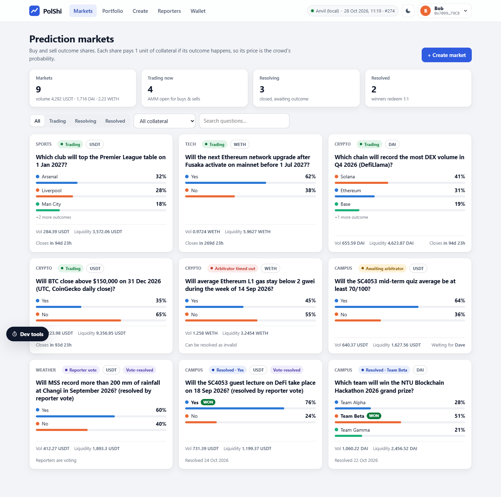
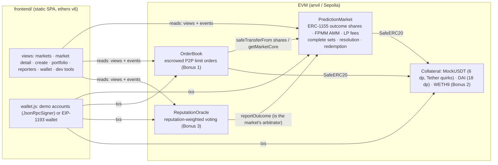

# PolShi — a decentralized prediction market (SC4053 · Option 4)

PolShi lets anyone open a market on a future real-world event, trade outcome shares whose prices are the crowd's
probabilities, and settle the market through a **named arbitrator** or a **reputation-weighted vote of registered
reporters**. Every outcome share is backed 1:1 by collateral, markets can be denominated in **USDT (6 decimals),
DAI (18) or WETH (18)**, and shares can also be traded **peer-to-peer** in an escrowed limit-order book before the
market resolves.



| What | Where |
|---|---|
| Solidity 0.8.33 contracts (Foundry, OpenZeppelin v5.7) | [`contracts/src`](contracts/src) |
| 180 tests: unit, revert-path, fuzz (512 runs), stateful invariants (96 runs × depth 48) — all passing, 100 % line/branch coverage of `src/` | [`contracts/test`](contracts/test) |
| One-command local demo (anvil + deploy + 10 days of seeded history + web server) | [`run.sh`](run.sh) |
| Static single-page app (vanilla JS + ethers v6, no build step) | [`frontend`](frontend) |
| Playwright end-to-end test through the real UI (41 checks) | [`e2e/smoke_test.py`](e2e/smoke_test.py) |
| Requirement-by-requirement status | [`CHECKLIST.md`](CHECKLIST.md) |

---

## Contents

1. [Quick start](#1-quick-start)
2. [Architecture](#2-architecture)
3. [Design decisions — the key questions](#3-design-decisions--the-key-questions)
4. [Security analysis](#4-security-analysis)
5. [Gas considerations](#5-gas-considerations)
6. [Running & testing](#6-running--testing)
7. [Live-demo script (≈7 minutes)](#7-live-demo-script-7-minutes)
8. [Known limitations & future work](#8-known-limitations--future-work)
9. [Test & coverage results](#9-test--coverage-results)

---

## 1. Quick start

Prerequisites: [Foundry](https://book.getfoundry.sh) (`forge`, `anvil`, `cast`) and Python 3 (stdlib only). No Node.js.
The contracts compile with via-IR, so a cold `forge build` takes a minute or two; afterwards `./run.sh` is ready in
about 30 seconds. OpenZeppelin and forge-std are git submodules in `contracts/lib`, so clone with `--recursive`
(or run `git submodule update --init --recursive` in an existing clone):

```bash
git clone --recursive https://github.com/BrandonChongWenJun/wisecrowd-prediction-market.git
cd wisecrowd-prediction-market
```

```bash
./run.sh                      # from any directory
# -> anvil on :8554 (chainId 31337), contracts deployed, demo history seeded, frontend on http://127.0.0.1:5554
```

Open **http://127.0.0.1:5554**. The wallet button (top right) offers two modes:

* **Demo accounts** (default on the local chain) — one click switches between anvil's pre-funded, unlocked
  accounts; no MetaMask needed. Roles in the seeded demo:

  | Account | Role | Account | Role |
  |---|---|---|---|
  | Alice | admin (contract owner), market creator, LP | Frank | reporter, trader |
  | Bob | trader | Grace | reporter, trader |
  | Carol | trader, P2P market maker | Heidi | reporter |
  | Dave | arbitrator of most markets | Ivan | trader, LP, the *absent* arbitrator of market #8 |
  | Eve | reporter | Judy | brand-new user (no tokens, no approvals) |

* **Browser wallet** — MetaMask or any EIP-1193 wallet. The app requests accounts, asks the wallet to switch to /
  add chain 31337 (`wallet_switchEthereumChain` / `wallet_addEthereumChain`), follows `accountsChanged` /
  `chainChanged`, and shows a banner on the wrong network. Import an anvil key into MetaMask to use it locally.

`ANVIL_PORT` / `WEB_PORT` override the ports, `SEED=0 ./run.sh` deploys without demo data. Ctrl-C stops everything
`run.sh` started (logs are in `.run/`).

---

## 2. Architecture



| Contract | Responsibility | Size (runtime) |
|---|---|---|
| [`PredictionMarket.sol`](contracts/src/PredictionMarket.sol) | Singleton holding every market: creation, complete-set split/merge, FPMM buy/sell, liquidity + fee accumulator, arbitrator report, timeout, redemption. Outcome shares are ERC-1155 ids `(marketId << 8) \| outcome`. | 21.2 KB |
| [`libraries/FpmmMath.sol`](contracts/src/libraries/FpmmMath.sol) | Pure FPMM math: buy amount, sell cost, exact-input sell search, spot prices. | (inlined) |
| [`OrderBook.sol`](contracts/src/OrderBook.sol) | Bonus 1: fully-escrowed limit orders (bids escrow collateral, asks escrow shares), partial fills, cancel, expiry. No owner. | 6.7 KB |
| [`ReputationOracle.sol`](contracts/src/ReputationOracle.sol) | Bonus 3: reporter registry, reputation-weighted votes, quorum, tie/no-quorum extension, reputation reward/slash; reports to the market as its arbitrator. | 8.0 KB |
| [`tokens/`](contracts/src/tokens) | `MockUSDT` (6 dp, **no bool return values, non-zero→non-zero approve reverts**, like Tether), `MockERC20` (DAI, 18 dp), `WETH9`. Mocks have public faucets for the demo. | |
| [`script/Deploy.s.sol`](contracts/script/Deploy.s.sol) | Deploys everything (or reuses existing USDT/DAI/WETH), configures the collateral allow-list, registers reporters, writes `deployments/<chainId>.json`. Works on anvil and public testnets. | |

Off-chain pieces: [`scripts/seed.py`](scripts/seed.py) (demo history with explicit block timestamps),
[`scripts/gen_config.py`](scripts/gen_config.py) (writes `frontend/config.js` with addresses + ABIs),
[`scripts/abi_lite.py`](scripts/abi_lite.py) (stdlib ABI encoder, self-tested against `cast calldata`).

**Why one singleton contract instead of a contract per market?** One ERC-1155 contract gives every outcome share
the same token address (the order book and wallets only integrate once), market creation costs ~0.4 M gas instead of
a multi-million-gas deployment, and the UI watches a single event source. Per-market accounting
(`collateralLocked`, `feePool`) keeps markets isolated inside the singleton — this is checked by the conservation
invariant and `test_marketsAreIsolated`.

---

## 3. Design decisions — the key questions

The handout lists no "tricky points" for this option, so these are the questions we think a prediction market
must answer, with our choice and the trade-offs.

### Q1. How are prices (odds) formed? — Gnosis-style fixed-product market maker (FPMM) on complete sets

| Option | Pros | Cons |
|---|---|---|
| Parimutuel pool | trivial | the price you get is only known after the market closes; no selling back |
| LMSR (Hanson) | bounded loss `b·ln N`, elegant | needs fixed-point `exp`/`ln` (rounding must be bounded explicitly to stay solvent), a fixed liquidity parameter, awkward multi-LP support |
| **FPMM (chosen)** | integer-only math, instant quotes, selling back, many LPs with fees, N outcomes, used in production (Gnosis/Omen) | an LP's loss is bounded by their deposit but can be large; prices of long shots can tick up when a third outcome is bought (see below) |

Mechanics (all in [`FpmmMath`](contracts/src/libraries/FpmmMath.sol)):

* **Buy** `x` collateral of outcome *i*: the fee is taken, the net amount `x'` mints `x'` complete sets into the
  pool, and the pool releases `b_i + x' − ending` shares of *i* where `ending = b_i · Π_{j≠i} b_j / (b_j + x')`, so the
  product of pool balances never decreases.
* **Sell** is *exact-input* (the user says "sell 100 shares, give me at least y"): the contract binary-searches the
  largest gross amount `g` such that `sharesToSell(g) ≤ sharesIn` (strictly monotone, ≤ ~100 iterations), merges `g`
  complete sets out of the pool, keeps the fee and pays the rest.
* **Price** of outcome *i* = `(1/b_i) / Σ_k (1/b_k)` — scarce outcomes are expensive; prices sum to exactly 1 up to one
  wei of rounding per outcome (fuzzed and checked as an invariant). Custom initial odds are supported: pool balances
  `b_i = F · min(p) / p_i` reproduce any starting probabilities (each ≥ 1 %).
* Slippage protection everywhere: `buy(minSharesOut)`, `sell(minCollateralOut)`, `addLiquidity(minShares)`,
  `removeLiquidity(minCollateralOut)`. The UI previews shares, average price, **price impact**, the probability after
  the trade, the fee and the payout, and applies a user-selectable tolerance (0.5–5 %).
* A property our fuzzer found and the README documents instead of hiding: with N > 2, buying outcome A always raises
  A's price and lowers the *sum* of the others, but an individual long shot can tick up slightly (the ratio
  `p_i/p_k = b_k/b_i` moves towards 1 when the same amount is added to both balances).

### Q2. Why is the market always solvent? — complete sets make it an identity

Every outcome token in existence — held by a user or virtually by the AMM pool — was created as part of a
**complete set** (1 collateral → 1 share of *every* outcome). The contract keeps
`collateralLocked = supply_i + pool_i` **for every outcome i** until resolution:

* buy: `+x'` to every pool balance and to `collateralLocked`, then shares move from pool to buyer;
* sell: shares move from seller to pool, then `g` sets are merged out (`−g` everywhere);
* split/merge, add/remove liquidity: symmetric by construction.

After resolution the maximum possible payout is `supply_w + pool_w = collateralLocked` (winner) or
`Σ_i (supply_i + pool_i) / N = collateralLocked` (invalid). Fees are kept separately in `feePool`, so
**token balance of the contract = Σ (collateralLocked + feePool)** over its markets.

Rounding always favours the protocol: every intermediate FPMM division rounds the balance the pool keeps *up*, fees
round *up*, payouts and LP-share mints round *down*, a new LP's contribution to each pool balance rounds *up*, and the
LP fee accumulator carries full-precision credits so the sum of fee payouts can never exceed the fees collected.
The rounding dust therefore stays in the contract (a few base units), never the other way round.

Proof in code: `invariant_collateralConservation`, `invariant_solvency`, `invariant_lpAccounting`,
`invariant_pricesAndPool` ([`MarketInvariants.t.sol`](contracts/test/invariant/MarketInvariants.t.sol)) run random
create / buy / sell / split / merge / add / remove / claim / transfer / time-travel / report / timeout / redeem
sequences over USDT, DAI and WETH markets (with `fail_on_revert = true`, so every call is a successful state
transition), plus fuzz tests that round trips (buy→sell, add→remove) never extract value.

### Q3. Who provides liquidity and how are they paid?

The creator must seed the pool (`initialLiquidity` ≥ a per-collateral minimum, e.g. 10 USDT) and becomes the first
LP; anyone can add more while trading is open. `addLiquidity` keeps prices unchanged: the pool keeps what it needs in
proportion to its current balances and returns the rest to the LP as outcome tokens (Gnosis semantics). A trading fee
(0–5 %, chosen at creation) accrues to LPs through a per-share accumulator; `claimFees` pays it at any time.
`removeLiquidity` is never paused: before resolution it returns the LP's slice of the pool, merging the balanced part
into collateral; after resolution it pays the slice's value directly — "LPs withdraw what they're owed" in one tx.
LP shares are non-transferable internal balances (simpler, exact fee accounting). What LPs risk, and how much trading
the fee needs to cover it, is in Q11.

### Q4. The oracle problem — who says what happened?

| Approach | Trust | Liveness | Cost | Used here |
|---|---|---|---|---|
| Trusted arbitrator (named at creation) | traders must trust one party | depends on that party → we add a timeout | cheap, instant | **yes (default)** |
| Reporter staking + disputes (Augur, UMA, Reality.eth escalation) | economic: lying costs the bond | dispute rounds take days | capital-intensive, complex | discussed only |
| Reputation-weighted committee vote | trust spread over reporters, weighted by track record | voting window + fallback | moderate | **yes (Bonus 3)** |
| External oracle feeds (Chainlink) | trust the feed | high | only for numeric questions | not needed |

Our choice: the market creator picks the resolution mode per market. A **trusted arbitrator** is an address
(person, multisig, DAO, or a contract such as our oracle) fixed at creation, so traders know whom they trust before
buying. It can only report inside `[resolutionTime, resolutionTime + 7 days)`, only once, and can also declare the
market **INVALID** (ambiguous question, cancelled event). Alternatively the market names the **ReputationOracle** as its
arbitrator: registered reporters vote and the oracle reports the consensus (Q9). A full Augur-style dispute game was
out of scope for a course project; we explain in §8 how it would plug in (the oracle is just another arbitrator).

### Q5. What if the event is cancelled, the question is ambiguous, or nobody reports?

* **INVALID** (reported by the arbitrator/oracle, or by timeout) pays **1/N collateral per share of any outcome**. This is
  the only refund rule that is exactly solvent *and* independent of who traded what: holders of complete sets — and
  therefore LPs — get their collateral back, and directional traders get the neutral value. A refund of each trader's
  *cost basis* is impossible to enforce because shares are transferable (ERC-1155 transfers, P2P fills).
* **Unresolved markets cannot lock funds:** if the arbitrator stays silent for 7 days after the resolution time,
  anyone can call `resolveAfterTimeout` → INVALID. After that the arbitrator can no longer report
  (`ReportingWindowClosed`), so the state is deterministic in time.

### Q6. Manipulation and MEV

* **Trading closes at `closeTime`** (set before the event) and reporting only opens at `resolutionTime ≥ closeTime`, so
  the AMM cannot be traded against a known result. P2P orders default to expire at the close time in the UI.
* **Sandwiching / front-running** a trade is bounded by the user's slippage limit (`SlippageExceeded` reverts); limit
  orders have a fixed price, so they cannot be sandwiched.
* **No on-chain consumer of AMM prices** exists (nothing borrows against or liquidates on them), so flash-loan price
  manipulation has no payoff beyond ordinary trading losses to arbitrageurs.
* **Donation / inflation attacks:** pool balances are internal accounting (never `balanceOf(this)`), direct ERC-20
  donations are ignored, the market contract is not an ERC-1155 receiver, and the order book rejects any ERC-1155
  transfer it did not initiate itself.
* **Arbitrator conflicts of interest** (the arbitrator trades then lies) cannot be prevented on-chain; mitigations are
  transparency (identity fixed up front), the reputation-vote mode, and the timeout.
* **Reporter herding** (voting with the visible majority to farm reputation) is possible with open voting — see Q9/§8.

### Q7. Secondary market (Bonus 1) — an escrowed P2P limit-order book

Separate from the AMM, holders can post **asks** (shares escrowed in the order book) and **bids** (collateral escrowed,
`ceil(amount·price)`), at 0.0001-precision prices strictly between 0 and 1 collateral per share. Takers fill any open
order **partially or fully**; makers can **cancel** any time (also after expiry or resolution) and get the unfilled
escrow back. Orders are fillable until the market resolves ("prior to event resolution"), so holders can still exit
after the AMM closes; optional expiry protects makers from stale quotes. Rounding: takers buying shares pay
`ceil(shares·price)`, takers selling receive `floor(shares·price)` from an escrow funded with `ceil(...)` — escrow can
never be over-drawn (fuzzed + invariant), and the dust returns to the maker on completion. No fees, no owner, no loops
over orders (paginated views for the UI).

### Q8. Multiple collateral assets (Bonus 2) and decimals

Markets are denominated in any allow-listed ERC-20 (`setCollateral`, owner-only, with a per-token minimum liquidity).
The demo deploys **USDT with 6 decimals that behaves like real Tether** (no return values, `approve` from non-zero to
non-zero reverts), an 18-decimal DAI and **WETH9** (wrap/unwrap in the UI). All accounting is in the token's base
units; outcome shares inherit the collateral's decimals (1 share base unit ↔ 1 collateral base unit), so no scaling
factors exist on-chain. Every transfer uses `SafeERC20`; incoming transfers are balance-checked and **fee-on-transfer
behaviour reverts** (`FeeOnTransferNotSupported`, including a token that switches its fee on later). The UI parses
and formats every amount with the token's own decimals (two display decimals for USDT/DAI, four for WETH, full
precision in inputs), approves exact amounts and resets a non-zero USDT allowance to 0 before re-approving.

### Q9. Reputation-weighted voting (Bonus 3)

[`ReputationOracle`](contracts/src/ReputationOracle.sol) is an alternative arbitrator:

* **Registry:** the owner registers reporters (Sybil resistance; capped at 50, which bounds every loop). New reporters
  start at 100 reputation; de-registered reporters keep their history (it cannot be reset by re-registering).
* **Voting window:** opens at the market's `resolutionTime` and lasts `votingPeriod` (1 day in the demo). A reporter
  votes once for an outcome or **INVALID**; the vote's **weight is the reporter's reputation at that moment**.
* **Quorum:** the voted weight must reach `quorumBps` (50 %) of the total reputation, snapshotted at the first vote
  (reporters registered after that snapshot may still vote, so the registry owner is trusted not to pack a live vote).
* **Finalize** (permissionless, after the window): a unique heaviest outcome with quorum is reported to the market;
  voters **with the consensus gain +10 reputation (cap 1000), voters against it lose 20 %** (rounded up, so persistent
  liars reach zero weight). **No quorum or a tie → the window is extended once**, by a full voting period counted from
  the moment the extension is triggered (capped just before the market's arbitration deadline); if it is still
  undecided the market resolves **INVALID** and no reputation changes. If nobody finalizes before the market's 7-day arbitration deadline the
  round is voided and the market becomes INVALID, so the oracle can never lock funds.
* Trade-offs: permissioned registration and non-transferable reputation instead of token staking (optional in the
  handout); open (not commit-reveal) voting — simpler demo, but later voters can see earlier votes (§8).

### Q10. Admin powers

`PredictionMarket` is `Ownable2Step`. The owner can only (1) allow/disallow collateral **for new markets** and set their
minimum liquidity, and (2) `pause` **new risk**: market creation, buy, sell, split and add-liquidity. The owner cannot
move funds, change outcomes, arbitrators or times, and **exits are never pausable** (merge, remove liquidity, claim
fees, report, timeout, redeem, cancel orders). The order book has no owner; the oracle owner only manages the registry.

### Q11. Does a 2 % fee pay liquidity providers for their risk? — only with enough uninformed volume

Every AMM trade is made against the pool, so **LPs as a group gain exactly what AMM traders as a group lose, fees
included, and lose what traders win** (complete-set splits/merges and P2P orders never touch the pool). Traders who
know more than the current price take money from the pool; the fee on every trade is how LPs get it back. This is the
classic market-maker problem (Glosten–Milgrom): the spread that uninformed traders pay, here the fee, has to cover
what the market maker loses to informed ones.

**What an LP holds.** Take a binary market seeded with `L` collateral at 50 % (pool: `L` Yes + `L` No). Fees are kept
outside the pool (Q2), so trades keep the product of the two balances at `L²` (rounding can only raise it). That
product and the Yes price `p` fix the pool, and with several LPs the same holds for each LP's slice:

```
Yes balance = L·√((1−p)/p)      No balance = L·√(p/(1−p))      value at fair prices = 2L·√(p(1−p))
```

* The pool depends only on **where the price is, not on how it got there**. A buy followed by a sell puts the pool
  back where it was and the LPs keep the fee on both legs, so uninformed two-way trading is pure profit for them
  (`test_sell_roundTripLosesOnlyFeesAndRounding`: a 100 USDT round trip costs the trader 3.96 USDT and leaves the
  price at 50 %).
* The LP loses whenever the price moves away from where they entered, in either direction: `1 − 2√(p(1−p))` of the
  deposit at fair prices. It is the same formula as Uniswap's impermanent loss, but here it is permanent: at
  resolution every price ends at 0 or 1 and never comes back.
* Withdrawing does not undo a move that has already happened: `removeLiquidity` pays out the LP's slice of the
  current, lopsided pool (Q3). It only stops further exposure.

**How much volume the fee needs.** The fee is 2 % of each trade, not 2 % of the deposit, so what matters is volume
relative to the size of the pool. If the closing price is the true probability, the LP breaks even when
`fee × volume ≥ L · (1 − 2√(p(1−p)))`, where volume counts every buy and sell, the informed ones included:

| AMM closes at (LP entered at 50 %) | LP's slice at fair prices | Expected loss | Break-even volume, 2 % fee | 5 % fee (max) | Buying needed to move the price there (2 % fee) |
|---|---|---|---|---|---|
| 60 % | 0.980 L | 2 % | 1.0 L | 0.4 L | 0.23 L |
| 70 % | 0.917 L | 8 % | 4.2 L | 1.7 L | 0.54 L |
| 80 % | 0.800 L | 20 % | 10 L | 4 L | 1.0 L |
| 90 % | 0.600 L | 40 % | 20 L | 8 L | 2.0 L |
| 95 % | 0.436 L | 56 % | 28 L | 11 L | 3.4 L |
| 99 % | 0.199 L | 80 % | 40 L | 16 L | 9.1 L |

**Worked example.** 1,000 USDT of liquidity at 50 %, 2 % fee. A trader who knows that Yes is 90 % likely buys Yes
until the price reaches 90 %: they pay 2,041 USDT (41 of it is the LPs' fee) for 2,667 Yes shares, leaving the pool
with 333 Yes and 3,000 No.

| Result | LP receives (pool slice + fees) | vs. 1,000 deposited |
|---|---|---|
| Yes (90 % likely) | 374 | −63 % |
| No (10 % likely) | 3,041 | +204 % |
| Expected | 641 | −36 % |
| INVALID | 1,707 | +71 % |

The trader's expected profit, 0.9 × 2,667 − 2,041 = 359, is exactly the LPs' expected loss. The fee recovered a
tenth of what the price move cost (41 of 400); recovering the other 359 takes ≈ 18,000 USDT (18 × the pool) of
round-trip volume from traders with no edge.

**INVALID favours LPs who entered at even odds:** every share pays 1/N, so their slice is worth the average of its
balances, and that average cannot fall below the deposit because the product of the balances never falls (AM–GM).
An LP who joined at other odds also got outcome tokens back (Q3) and can gain or lose under INVALID.

**Protections already in the design**

* **No trading against a known result.** The AMM closes at `closeTime` and reporting opens at
  `resolutionTime ≥ closeTime` (Q6). With `closeTime` set before the event starts, nobody can buy the winner from the
  pool after the fact, the most damaging kind of informed trade. Adding liquidity also stops at `closeTime`.
* **Losses are capped at the deposit.** Fees go to `feePool`, outside the pool, and can be claimed at any time, so
  fees already earned are never at risk.
* **Exits are never paused** (Q10), so an LP can leave before scheduled news, within the limit described above.
* **The creator sets the opening odds** (Q1). LPs lose on the distance the price travels from where they entered, so
  accurate odds are the cheapest protection: a market opened at 50 % on a 90 % event costs its LPs 40 % of the
  deposit before fees. LPs who join later enter at the current price and do not pay for earlier moves.
* **The fee is set per market** (0–5 %; the UI defaults to 2 %). A creator who expects informed trading can charge
  more, but traders then need a bigger edge before a trade pays, so prices follow news more slowly.
* Rounding always favours the pool, i.e. the LPs (Q2).

**So who would provide liquidity?** A passive LP who seeds at the opening odds and holds to resolution loses money, on
average, in exactly the markets that turn out most informative. In this design liquidity comes from:

* **creators acting as sponsors**: every creator is the first LP, and the expected loss is what they pay for a crowd
  forecast (Hanson's view of automated market makers: the sponsor's subsidy pays traders for information);
* **LPs who think the price is already right** and expect heavy two-way trading (popular sports or election markets),
  where volume runs to many times the pool;
* **active LPs** who withdraw before scheduled news and come back afterwards.

It does not work as a passive "2 % yield". Production markets reached the same conclusion: Polymarket replaced its AMM
with an order book at the end of 2022, where market makers set their own prices, can cancel quotes when news breaks,
and receive liquidity rewards.

**What we would add next** (also listed in §8)

1. **A fee that rises towards `closeTime`** (e.g. 2 % → 5 % over the last day), when trades are most likely to be
   informed. `_feeOn` would take the market instead of a fixed `feeBps`; late casual traders would pay more too.
2. **An LP risk preview** in the Liquidity tab: what the LP's slice pays if each outcome wins, and the volume needed
   to break even (each market already records its `volume`, shown on the market page).
3. **Maker incentives in the order book**, such as a small taker fee paid to makers or rewards for quotes near the mid
   price. Makers already set their own prices and can cancel (Q7), so they avoid the passive LP's problem, but
   nothing pays them for quoting.
4. **LMSR for sponsored markets**: the sponsor's worst-case loss is known up front (`b·ln N`, ≈ 0.69·b for a binary
   market) instead of "up to the whole deposit", at the cost of fixed-point `exp`/`ln` and a fixed liquidity
   parameter (Q1).

---

## 4. Security analysis

| Threat | Mitigation | Evidence |
|---|---|---|
| Re-entrancy through ERC-1155 receiver hooks or ERC-777-style collateral | `nonReentrant` (OZ `ReentrancyGuardTransient`) on every function that moves value or calls another contract (all trading, liquidity, resolution, redemption, order and voting functions; the owner-only setters make no external calls); checks-effects-interactions with the ERC-1155 mint/transfer (receiver hook) always last | `Security.t.sol`: hooks re-entering buy, sell, removeLiquidity, redeem, order cancel; malicious collateral re-entering redeem |
| Insolvency / value leak through rounding | directions listed in Q2; `Math.mulDiv` with explicit rounding; full-precision fee credits | fuzz: round trips never profitable; invariants: conservation, backing, fee coverage |
| Non-standard ERC-20s (USDT) | `SafeERC20`; exact approvals + 0-reset in the UI | `Tokens.t.sol`, USDT used as main collateral in most tests |
| Fee-on-transfer / rebasing tokens | owner allow-list **and** balance-delta check on every pull (market + order book) | `test_revert_feeOnTransferCollateral`, `FeeToggleTest` |
| Donation / share-inflation attacks | internal pool balances, LP shares minted vs. pool weight, ERC-1155 transfers to the market/order book rejected | `test_donationsDoNotAffectPricesOrAccounting`, `test_rejectsDirectErc1155Transfers` |
| Front-running, sandwiching | slippage bounds on buy/sell/add/remove; fixed-price limit orders; UI quotes refreshed every block | `test_revert_buy_frontRunTriggersSlippage` |
| Trading on a known outcome | AMM closes at `closeTime`; reporting only from `resolutionTime`; order expiry | `test_revert_buy_afterClose`, `test_revert_report_tooEarly` |
| Absent or late arbitrator | 7-day window, then permissionless INVALID | `test_timeout_resolvesInvalid`, `test_revert_report_afterWindow` |
| Wrong party resolving | `msg.sender == market.arbitrator`; oracle checks it is the market's arbitrator | `test_revert_report_notArbitrator`, `test_arbitratorCannotReportForOtherMarkets`, `NotOracleMarket` tests |
| Reporter Sybils / vote gaming | permissioned registry, one vote per reporter, weight fixed at vote time, quorum snapshot, ties → extension → INVALID | `ReputationOracle.t.sol`, `OracleInvariants.t.sol` |
| Admin abuse / key compromise | 2-step ownership; admin cannot touch funds or outcomes; exits never paused | `test_report_allowedWhilePaused`, `test_removeLiquidity_allowedWhilePausedAndAfterClose`, `test_fees_claimableAfterResolutionAndWhilePaused` |
| Gas DoS / unbounded loops | loops bounded by outcomes (≤ 8), reporters (≤ 50), a 256-step binary search; order lists paginated | `test_maxReporters`, `test_createEightOutcomes` |
| Markets interfering with each other | per-market `collateralLocked` / `feePool`; per-token conservation invariant | `test_marketsAreIsolated`, `invariant_collateralConservation` |
| Timestamp manipulation | only day-scale windows; a validator's few seconds of drift are irrelevant | — |
| XSS through market text in the dApp | all user-supplied strings are HTML-escaped (`esc`) or set via `textContent` | code review (`frontend/js/format.js`) |

Residual risks we accept (see §8): a trusted arbitrator can lie; open reputation voting allows herding; mock tokens are
freely mintable (demo only).

---

## 5. Gas considerations

Measured with `forge test --gas-report` (via-IR, optimizer 200 runs; median of the unit tests):

| Function | Median gas | Notes |
|---|---|---|
| `createMarket` (binary / 8 outcomes max) | 394 k / 722 k | question + labels stored on-chain (UI reads them without an indexer) |
| `buy` | 165 k | first purchase of a token id pays the ERC-1155 balance + supply SSTOREs |
| `sell` | 104 k (max 273 k) | exact-input binary search: ≤ ~100 × (N−1) `mulDiv`s, in exchange for "sell exactly X shares" UX |
| `splitPosition` / `mergePositions` | 138 k / 49 k | batch mint/burn of N ids |
| `addLiquidity` / `removeLiquidity` / `claimFees` | 108 k / 88 k / 78 k | fee accumulator is O(1) per LP |
| `reportOutcome` / `resolveAfterTimeout` / `redeem` | 55 k / 41 k / 67 k | redeem burns all N ids in one batch |
| `placeOrder` / `fillOrder` / `cancelOrder` | 256 k / 88 k / 52 k | an order is one struct (6 storage slots) + an index entry |
| `vote` / `finalize` (4 voters) | 124 k / 161 k | finalize loops over ≤ 50 voters |

Choices made for gas: a singleton (no per-market deployment); **virtual pool balances** (the AMM's shares are never
minted as ERC-1155 tokens); packed market header (collateral + close time + flags in one slot);
`ReentrancyGuardTransient` (EIP-1153 transient storage); custom errors; the probability chart is built from a
`PoolUpdated(balances, timestamp)` event rather than extra storage; **via-IR** compilation keeps
`PredictionMarket` at 21.2 KB (3.4 KB under the EIP-170 limit; the legacy pipeline produced 24.4 KB). What we
deliberately did *not* optimise: strings in storage (could move to IPFS/events + an indexer) and the sell search
(a closed form exists for binary markets only).

---

## 6. Running & testing

### Local demo
```bash
./run.sh                          # ANVIL_PORT=8554 WEB_PORT=5554 by default
```
It checks the ports are free (it never kills other processes), starts `anvil --timestamp <now − 10 days>`, runs
`forge build` + `script/Deploy.s.sol`, seeds 10 days of history with explicit block timestamps (≈ 265 transactions),
switches anvil to 1-second interval mining so **chain time follows the wall clock**, writes `frontend/config.js` and
serves `frontend/` with `python3 -m http.server`. The dApp always reasons about the **latest block timestamp**; the
Dev tools panel (local chain only) calls `evm_increaseTime` + `evm_mine` (+1 h / +1 day / +7 days / custom / "jump to
the next deadline").

### Contract tests
```bash
cd contracts
forge test                         # 180 tests (unit, fuzz, invariants)   ~15 s after compilation
forge coverage --report summary    # coverage disables via-IR/optimizer automatically
forge fmt --check
```

### End-to-end test (real UI, real chain)
```bash
python3 e2e/smoke_test.py            # starts a fresh ./run.sh on 8554/5554, runs, stops it
python3 e2e/smoke_test.py --no-start # against an already running, freshly started ./run.sh
```
It needs Playwright for Python with Chromium (in the course VM: `<scratchpad>/pw e2e/smoke_test.py`). It uses the demo
accounts plus an injected mock EIP-1193 provider for the browser-wallet path, asserts on-screen outcomes (41 checks)
and saves screenshots to [`e2e/screenshots/`](e2e/screenshots).

### Deploying to a public testnet (not done for this submission)
```bash
cd contracts
forge script script/Deploy.s.sol --rpc-url "$SEPOLIA_RPC_URL" --private-key "$PRIVATE_KEY" --broadcast
#   optional env: OWNER=0x…  REPORTERS=0xA,0xB  VOTING_PERIOD=86400  QUORUM_BPS=5000
#                 WETH_ADDRESS=<canonical WETH on that chain>  USDT_ADDRESS=…  DAI_ADDRESS=…  (mocks are deployed otherwise)
python3 ../scripts/gen_config.py --deployment deployments/11155111.json --rpc-url "$SEPOLIA_RPC_URL" --chain-name Sepolia
python3 -m http.server 5554 --directory ../frontend   # then connect MetaMask (demo accounts are local-only)
```
`PRIVATE_KEY` may also be exported instead of passing `--private-key` (the script picks it up), and `--account <keystore>`
works too. With `OWNER` set, ownership is offered via `Ownable2Step` and must be accepted by the new owner.

---

## 7. Live-demo script (≈7 minutes)

Before class: `./run.sh`, open http://127.0.0.1:5554 in a full-screen browser window (light theme; zoom 110 %).
The seeded state already contains everything below; nothing needs to be prepared by hand.

| Time | Do | Point out |
|---|---|---|
| 0:00 | **Markets** page (account: Bob). | 9 markets in 3 collaterals; each card shows live odds; phases: Trading, Reporter vote, Awaiting arbitrator, Arbitrator timed out, Resolved. Chain clock top right = latest block time. |
| 0:40 | Open **#1 BTC > $150k**. Hover the chart; toggle *Table view*. | Probabilities come from `PoolUpdated` events; prices always sum to 100 %. |
| 1:10 | Trade panel: *Buy Yes*, type **250** USDT. Then click **Buy Yes**. | Quote: shares, average price, **price impact**, probability after trade, fee, payout; slippage selector. Toast goes pending → confirmed; odds and position update. Explain complete sets ⇒ solvency. |
| 2:10 | Tab **Order book (P2P)** → *Sell (ask)*, price **0.45**, **50** shares → *Place sell order*. Switch account to **Frank** → *Buy* on that order → **20** → confirm. Switch back to **Bob** → *Cancel*. | Shares are escrowed on-chain, partial fills, remainder refunded on cancel; P2P stays open after the AMM closes, until resolution. |
| 3:20 | Open **#5 SC4053 quiz** → switch to **Dave** (arbitrator) → pick *Yes* → *Report*. Switch to **Bob** → **Redeem**. | Only the named arbitrator can report, only after the resolution time; winners get 1 USDT per share. |
| 4:10 | Open **#4 Rainfall (reporter vote)**. Eve has already voted. Switch to **Frank** → vote *Yes*; **Heidi** → vote *No*. | Weights = reputation (Heidi has 80 after a wrong vote earlier), quorum bar (50 %), tally incl. INVALID. |
| 5:00 | **Dev tools** (bottom left) → **+1 day** → *Finalize vote*. Open **Reporters**. | Consensus reported to the market; Frank +10, Heidi −20 %. No quorum / tie would extend voting once, then INVALID. |
| 5:50 | Open **#8 L1 gas** (arbitrator Ivan never reported) → *Resolve as invalid* → **Redeem**. | Liveness: after 7 days anyone can void the market; INVALID pays 1/N per share (complete sets are made whole). |
| 6:30 | Switch to **Judy** (new user) → **Wallet** → *Get 10,000 USDT* → **Create**: question, 3 outcomes, *Set initial odds*, collateral **USDT (6 dp)** or **WETH**, arbitrator or *Reputation-weighted vote* → *Create market*. | Exact-amount approval then creation; the creator becomes the first LP. |
| 7:10 | Wrap up. | 180 Foundry tests incl. invariants proving solvency; 100 % coverage of `src/`; e2e test drives this exact UI. |

Fallback if something goes wrong live: Ctrl-C and `./run.sh` again gives the identical seeded state in ~30 s.

---

## 8. Known limitations & future work

* **Trusted arbitrator**: can lie (the handout's model). Future: a bonded dispute/escalation game (Reality.eth style)
  that ends in the ReputationOracle — it only has to call `reportOutcome`, like any arbitrator.
* **Reputation oracle**: permissioned registry; not stake-backed (the handout marks staking as optional); open voting
  allows herding and late copying — commit-reveal voting would fix it at the cost of a second transaction per vote;
  reporters are not prevented from trading the markets they vote on.
* **INVALID = 1/N per share**, not a refund of each trader's cost basis (impossible with transferable shares, Q5).
* **LP shares are not tokens** (non-transferable).
* **LPs lose to informed traders**: a passive LP who holds to resolution needs volume of many times the pool to break
  even at a 2 % fee, and can lose most of the deposit in a market whose price moves far (Q11). Future: a fee that
  rises towards `closeTime`, an LP risk preview, maker incentives in the order book, LMSR for sponsored markets.
* **Order book** fills one order per transaction (no batch/route across price levels, no AMM+book routing) and has no
  matching of a YES bid with a NO bid via minting.
* **On-chain strings** cost gas; the UI reads history with `eth_getLogs` from the deployment block, which is fine on
  anvil but would need an indexer (e.g. a subgraph) on a busy public chain.
* **Scalar markets** (numeric ranges) and more than 8 outcomes are not supported.
* **Demo conveniences**: mock USDT/DAI have public mint/faucet; anvil's well-known keys are used by `run.sh` only.
  MetaMask caches nonces per chain id — after restarting anvil, reset the account in MetaMask.
* Trades have no explicit `deadline` parameter; stale transactions are bounded by the slippage limit and `closeTime`.

---

## 9. Test & coverage results

`forge test` (Foundry 1.5.1, solc 0.8.33, via-IR) — **180 passed, 0 failed**:

```
Ran 28 tests for test/PredictionMarket.Create.t.sol:PredictionMarketCreateTest          28 passed
Ran 29 tests for test/PredictionMarket.Trading.t.sol:PredictionMarketTradingTest        29 passed
Ran 16 tests for test/PredictionMarket.Liquidity.t.sol:PredictionMarketLiquidityTest    16 passed
Ran 16 tests for test/PredictionMarket.Resolution.t.sol:PredictionMarketResolutionTest  16 passed
Ran  5 tests for test/PredictionMarket.Fuzz.t.sol:PredictionMarketFuzzTest              5 passed (512 runs each)
Ran 11 tests for test/FpmmMath.t.sol:FpmmMathTest                                       11 passed (6 fuzz)
Ran 22 tests for test/OrderBook.t.sol:OrderBookTest                                     22 passed (2 fuzz)
Ran 25 tests for test/ReputationOracle.t.sol:ReputationOracleTest                       25 passed
Ran  9 tests for test/Security.t.sol:SecurityTest                                       9 passed
Ran  1 test  for test/Security.t.sol:FeeToggleTest                                      1 passed
Ran  9 tests for test/Tokens.t.sol:TokensTest                                           9 passed
Ran  1 test  for test/Deploy.t.sol:DeployScriptTest                                     1 passed
Ran  4 tests for test/invariant/MarketInvariants.t.sol:MarketInvariantsTest             4 passed (96 runs × 48 calls)
Ran  2 tests for test/invariant/OrderBookInvariants.t.sol:OrderBookInvariantsTest       2 passed (96 runs × 48 calls)
Ran  2 tests for test/invariant/OracleInvariants.t.sol:OracleInvariantsTest             2 passed (96 runs × 48 calls)
Ran 15 test suites: 180 tests passed, 0 failed, 0 skipped (180 total tests)
```

`forge coverage --report summary` (all of `src/` at 100 % lines, statements, branches and functions; the other rows
are the deploy script and test helpers):

```
| File                                     | % Lines            | % Statements       | % Branches       | % Funcs          |
| script/Deploy.s.sol                      | 94.44% (51/54)     | 95.38% (62/65)     | 62.50% (5/8)     | 100.00% (2/2)    |
| src/OrderBook.sol                        | 100.00% (93/93)    | 100.00% (128/128)  | 100.00% (30/30)  | 100.00% (10/10)  |
| src/PredictionMarket.sol                 | 100.00% (405/405)  | 100.00% (524/524)  | 100.00% (73/73)  | 100.00% (48/48)  |
| src/ReputationOracle.sol                 | 100.00% (155/155)  | 100.00% (198/198)  | 100.00% (31/31)  | 100.00% (14/14)  |
| src/libraries/FpmmMath.sol               | 100.00% (40/40)    | 100.00% (58/58)    | 100.00% (6/6)    | 100.00% (4/4)    |
| src/tokens/MockERC20.sol                 | 100.00% (9/9)      | 100.00% (5/5)      | 100.00% (0/0)    | 100.00% (4/4)    |
| src/tokens/MockUSDT.sol                  | 100.00% (27/27)    | 100.00% (28/28)    | 100.00% (6/6)    | 100.00% (7/7)    |
| src/tokens/WETH9.sol                     | 100.00% (28/28)    | 100.00% (29/29)    | 100.00% (5/5)    | 100.00% (7/7)    |
| test/FpmmMath.t.sol                      | 100.00% (8/8)      | 100.00% (8/8)      | 100.00% (0/0)    | 100.00% (4/4)    |
| test/PredictionMarket.Create.t.sol       | 100.00% (8/8)      | 100.00% (9/9)      | 100.00% (2/2)    | 100.00% (2/2)    |
| test/Security.t.sol                      | 95.65% (66/69)     | 92.54% (62/67)     | 93.75% (15/16)   | 95.00% (19/20)   |
| test/Tokens.t.sol                        | 100.00% (6/6)      | 100.00% (3/3)      | 100.00% (0/0)    | 100.00% (3/3)    |
| test/invariant/MarketHandler.sol         | 97.28% (179/184)   | 98.36% (240/244)   | 96.00% (24/25)   | 90.91% (20/22)   |
| test/invariant/OracleInvariants.t.sol    | 93.75% (60/64)     | 97.75% (87/89)     | 100.00% (10/10)  | 77.78% (7/9)     |
| test/invariant/OrderBookInvariants.t.sol | 100.00% (78/78)    | 97.48% (116/119)   | 85.00% (17/20)   | 100.00% (10/10)  |
| test/utils/BaseTest.sol                  | 97.33% (73/75)     | 97.30% (72/74)     | 100.00% (1/1)    | 92.31% (12/13)   |
| Total                                    | 98.70% (1286/1303) | 98.85% (1629/1648) | 96.57% (225/233) | 96.65% (173/179) |
```

Invariants (all `fail_on_revert = true`): collateral conservation per token, full backing of every outcome before
resolution, solvency after resolution, LP fee coverage and share accounting, price sum and pool shape
(`MarketInvariants`); order-book escrow equals open orders and tokens/collateral are conserved (`OrderBookInvariants`);
total reputation equals the registry sum and finalized rounds agree with the market (`OracleInvariants`).

End-to-end: `e2e/smoke_test.py` → **E2E PASSED: 41 checks** (fresh `./run.sh`, ≈95 s including startup).
